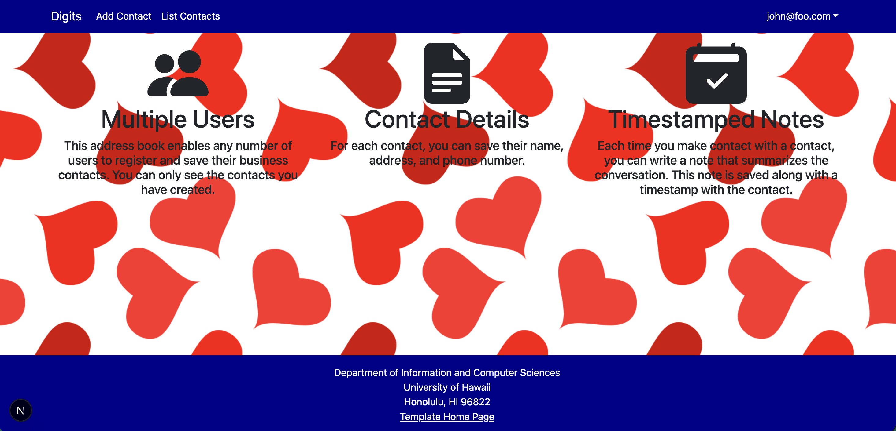

## Main Page

This webpage displays the contacts of the faculty at the University of Hawaii at Manoa. The user can login with valid credentials, add a contact, look at all the previous contacts, and add a timestamped note to their contact. The admin user can do everything a standard user can do and also manange the page. 

## Installation

Run npm run dev to start the application (localhost3000). Open the localhost application, and it will take you to the main login page. 

## Walkthrough

The first page you are greeted with after you login with valid credentials is the landing page where you are shown what actions you can do on this page. This includes adding your own contact, viewing a list of the current contacts, and adding a note to your contact. 

You can next click on the options on the top navbar to show the rest of the pages. clicking, 'add contact' will take you to an input page where you can type in your first and last name, address, a picture of yourself, and a description of what your interests are. 

Clicking on the 'list contacts' options shows all the current contacts listed in the database. 

